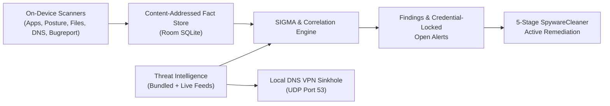

# AndroDR — Open-Source Android Spyware & Malware EDR

[](LICENSE)
[-3DDC84.svg)](https://developer.android.com)
[](https://goonline.ma)
[](https://goonline.ma)

**AndroDR** is a 100% open-source, on-device **Android Endpoint Detection & Active Remediation (EDR)** platform engineered and maintained by **Big M Solutions** and **[GoOnline.ma](https://goonline.ma)**.

It detects and neutralizes state-grade mercenary spyware, remote-access trojans (RATs), device-takeover (DTO) banking malware, commercial stalkerware, and silent carrier preload installers **entirely locally on your phone** — with zero cloud servers, zero user accounts, and zero telemetry exfiltration.

---

## Accelerated by [GoOnline.ma](https://goonline.ma) — Digital Growth, Custom Engineering & Cybersecurity

> **Looking to build high-performance web platforms, custom enterprise/mobile software, or scale your digital acquisition?**
>
> **[GoOnline.ma](https://goonline.ma)** (*Go Online By Big M Solutions*) helps ambitious companies across **Morocco (Casablanca), Canada, and the United States** turn their digital presence and software stack into measurable engines of growth, security, and authority.

| Core Practice | What [GoOnline.ma](https://goonline.ma) Delivers |
| :--- | :--- |
| **Custom Web & E-Commerce Engineering** | Ultra-fast, conversion-focused showcase websites, custom e-commerce stores, high-impact landing pages, and full platform modernization ([Explore Web Creation](https://goonline.ma/services-creation-site-web-maroc/)). |
| **Bespoke Software, SaaS & Mobile Apps** | Custom ERP/CRM systems, client portals, SaaS products, native mobile & security applications, API integrations, and end-to-end business workflow automation. |
| **SEO & Organic Search Dominance** | Technical & semantic SEO, Google rankings, Local SEO, Google Business Profile optimization, and online brand reputation management so customers find and trust you first. |
| **Multichannel Paid Acquisition & Influence** | ROI-engineered ad campaigns across **Meta, Google, TikTok, Microsoft, Pinterest, and Spotify**, paired with UGC production, creator partnerships, and full **GA4 / GTM** conversion tracking. |
| **Cybersecurity, Cloud Care & Maintenance** | Hardened application security, proactive patching, encrypted backups, managed hosting, and continuous performance optimization. |

**Clear scope. Zero ambiguity. Measurable ROI.**
- **Website:** [https://goonline.ma](https://goonline.ma)
- **Request Your Free Strategy & Digital Audit:** [https://goonline.ma/contact/](https://goonline.ma/contact/)
- **Direct Contact:** `contact@goonline.ma`

---

## Why AndroDR Is 100% Open Source

An Android security tool requires deep system visibility (`QUERY_ALL_PACKAGES`, `PACKAGE_USAGE_STATS`, and local `VpnService` DNS inspection). Closed-source "antivirus" apps ask users to trust a black box with those privileges. **AndroDR takes the opposite approach:**

1. **Auditable Detection Logic (Rules as Data, Not Black-Box Code):** Detections are expressed as human-readable [SIGMA](https://github.com/SigmaHQ/sigma) YAML rules and structured JSON/YAML threat feeds — anyone can inspect why an alert triggered.
2. **Zero Cloud / Zero Tracking Architecture:** Every scan, forensic timeline correlation, bug-report analysis, and active cleanup runs strictly on-device inside Room SQLite storage.
3. **Verifiable Builds & Automated Guardrails:** Over 200 unit, schema, and security regression tests enforce zero fabricated IOCs, strict network-security pinning, and clean static analysis (`detekt`).

---

## Open-Source Project Structure

AndroDR is organized as a single-application Kotlin + Jetpack Compose Gradle project with clean package boundaries separating **telemetry collection**, **SIGMA rule evaluation**, **threat intelligence**, **active remediation**, and **Material 3 UI**:

```text
AndroDR/
├── app/
│   ├── build.gradle.kts                   # Android SDK 36 config, Hilt/KSP, R8 minify, release signing
│   ├── proguard-rules.pro                 # R8 keep rules for serialization, Room, and SIGMA models
│   └── src/
│       ├── main/
│       │   ├── AndroidManifest.xml        # Permissions, DnsVpnService, FileProvider, boot receivers
│       │   ├── java/com/androdr/
│       │   │   ├── AndroDRApplication.kt  # Hilt entry point & background worker initialization
│       │   │   ├── MainActivity.kt        # Compose host & 5-tab navigation graph
│       │   │   ├── remediation/           # 5-stage Active Spyware & Malware Cleaner (SpywareCleaner)
│       │   │   ├── scanner/               # On-device emitters (apps, AppOps, posture, files, bugreports)
│       │   │   ├── sigma/                 # SIGMA YAML parser, rule evaluator & event correlation engine
│       │   │   ├── ioc/                   # Threat-intel resolvers & remote/bundled feed updaters
│       │   │   ├── network/               # Local UDP-53 DNS VPN monitor & C2 domain sinkhole
│       │   │   ├── privacy/               # Exodus tracker code scanner & DNS tracker crossover
│       │   │   ├── data/                  # Room SQLite database, DAOs, fact store & repositories
│       │   │   ├── reporting/             # Forensic reports, STIX 2.1 JSON export & timeline builder
│       │   │   ├── integrity/             # Self-integrity & runtime environment verification
│       │   │   ├── di/                    # Dagger Hilt dependency-injection modules
│       │   │   ├── ui/                    # Jetpack Compose Material 3 screens & Hilt ViewModels
│       │   │   │   ├── dashboard/         # Risk summary, Active Threat Remediation card & Open Alerts
│       │   │   │   ├── apps/              # Per-package findings, tracker crossover & 1-tap uninstall
│       │   │   │   ├── device/            # OS posture, ADB/bootloader & CVE patch audit screen
│       │   │   │   ├── network/           # Real-time DNS VPN monitor & domain blocklist controls
│       │   │   │   ├── privacy/           # Embedded tracker SDK inspector & refusal thresholds
│       │   │   │   ├── timeline/          # 24h/7d/30d forensic timeline & correlated event clusters
│       │   │   │   ├── bugreport/         # Android bug report (.zip) & Android 16+ Intrusion Log analyzer
│       │   │   │   ├── history/           # Scan diffing, snapshot retention & JSONL export
│       │   │   │   ├── telemetry/         # Fact-store record browser & cross-scan diff viewer
│       │   │   │   ├── settings/          # Feed health, custom rule URLs, STIX/CSV exports & theme
│       │   │   │   ├── security/          # Biometric / device-credential confirmation gates
│       │   │   │   └── theme/             # WCAG AA dark/light color tokens (ExtendedColors)
│       │   │   └── util/                  # Bounded I/O readers & display-safe text sanitizers
│       │   └── res/
│       │       ├── raw/                   # Bundled offline SIGMA rules & threat-intel databases
│       │       │   ├── sigma_androdr_*.yml          # 90+ bundled SIGMA detection & correlation rules
│       │       │   ├── known_bad_packages.json      # Malicious & spyware Android package IDs
│       │       │   ├── known_bad_apk_hashes.json    # SHA-256 APK file indicators
│       │       │   ├── known_bad_certs.json         # Malicious signing certificate fingerprints
│       │       │   ├── known_bad_domains.json       # C2 & stalkerware domains for DNS sinkholing
│       │       │   ├── known_spyware_artifacts.yml  # Filesystem staging paths (Pegasus, RatHat, etc.)
│       │       │   ├── known_exploited_cves.json    # CISA KEV + Android Security Bulletin zero-days
│       │       │   ├── known_oem_prefixes.yml       # Verified OEM system-package prefix allowlists
│       │       │   └── known_good_apps.json         # Verified F-Droid / Play Store baseline catalog
│       │       └── values/strings.xml     # Externalized UI strings & accessibility labels
│       └── test/java/com/androdr/         # 200+ JVM & Robolectric unit, parser & security gate tests
├── config/
│   └── detekt.yml                         # Security-focused Kotlin static analysis ruleset
├── docs/
│   └── ARCHITECTURE.md                    # Deep-dive specification & canonical data-model glossary
├── scripts/                               # Rule sync, IOC verification & maintainer automation scripts
├── test-adversary/                        # Benign synthetic test fixtures for validating rule coverage
└── third-party/
    └── android-sigma-rules/               # Upstream SIGMA rule & indicator mirror submodule
```

### On-Device Data Flow



### Core Package Guide for Contributors

| Package | Responsibility | Key Classes |
| :--- | :--- | :--- |
| `com.androdr.remediation` | Live heuristic implant detection (disguised Go `.so` RATs, `NFC`+`DUMP`, `VPN`+`Accessibility`, silent preloaders) and 5-stage active threat cleanup. | `SpywareCleaner`, `ImplantFinding`, `CleanReport` |
| `com.androdr.scanner` | Collects structured device & package facts without making detection judgments inside emitters. | `AppScanner`, `AppOpsScanner`, `DeviceScanner`, `FileArtifactScanner`, `BugReportAnalyzer` |
| `com.androdr.sigma` | Parses SIGMA YAML rules and multi-event correlation chains and evaluates them against emitted telemetry records. | `SigmaRuleParser`, `SigmaRuleEngine`, `SigmaCorrelationEngine` |
| `com.androdr.ioc` | Loads bundled raw JSON/YAML indicators and merges verified remote feed updates at runtime. | `IndicatorResolver`, `IocDatabase`, `BundledDomainDatabase`, `KnownSpywareArtifactsResolver` |
| `com.androdr.network` | Runs an optional battery-optimized local `VpnService` intercepting UDP/53 DNS queries to log or sinkhole C2 domains. | `DnsVpnService`, `BlocklistManager`, `DnsLogBuffer` |
| `com.androdr.privacy` | Inspects APK DEX package trees against the Exodus Privacy tracker registry and correlates DNS lookups. | `PrivacyScanner`, `PrivacyRanking` |
| `com.androdr.data` | Deduplicated Room SQLite fact store, open-alert lifecycle (locked behind screen-lock confirmation), and CVE repository. | `AppDatabase`, `FindingsRepository`, `CveRepository`, `SettingsRepository` |
| `com.androdr.reporting` | Generates human-readable reports, forensic timelines, app SHA-256 CSVs, and MISP/SIEM-ready STIX 2.1 bundles. | `StixExporter`, `ReportGenerator` |

See [`docs/ARCHITECTURE.md`](docs/ARCHITECTURE.md) for the complete architectural specification and canonical glossary.

---

## Threat Coverage & Active Remediation

### 1. November 2026 Threat Intelligence
- **Mercenary & State-Sponsored Spyware:** Pegasus (NSO Group), Predator (Intellexa), Graphite (Paragon), NoviSpy, ResidentBat, TaxiSpy, and Cellebrite forensic staging artifacts.
- **2026 RATs & Device-Takeover (DTO) Trojans:** Mirax (Aquafina campaign packages + dual-WebSocket C2 sinkholing), RatHat (disguised Go `.so` native libraries + Wireless Debugging ADB self-pairing), WindRelay + SpyNote (`NFC` contactless relay + `DUMP`), RemControl & ToxicPanda 2.0 (`BIND_VPN_SERVICE` Play-Protect blinding + `BIND_ACCESSIBILITY_SERVICE`), BingoMod, Crocodilus, NGate, TrickMo, and Brokewell.
- **Commercial Stalkerware & Covert Preloaders:** mSpy, FlexiSPY, TheTruthSpy, Cocospy, Hoverwatch, and silent OEM/carrier setup installers (`com.ironsource.appcloud.oobe*`, `com.aura.oobe.*`, `com.dti.*`).
- **Exploited Android CVEs (through Nov 2026):** Audits OS patch levels against CISA KEV and critical zero-click vulnerabilities including `CVE-2026-58868` (`FrameDecoder.cpp` RCE), `CVE-2026-58882` (zero-interaction WAP Push SMS), and `CVE-2026-58704` (baseband modem zero-day).

### 2. 5-Stage Active Threat Remediation (`SpywareCleaner`)
1. **Process Termination:** Immediately kills active background processes of flagged packages.
2. **Dropper & Artifact Purge:** Cleans shared-storage dropper APKs, hidden staging configs, and RatHat touch-coordinate logs (`locateValues.json`).
3. **Privileged Root / Shell Eradication (when `su` is available):** Force-stops implants, revokes dangerous `appops` (`ACCESS_RESTRICTED_SETTINGS`, `PROJECT_MEDIA`, `SYSTEM_ALERT_WINDOW`, `RECORD_AUDIO`, `CAMERA`, `FINE_LOCATION`, `READ_SMS`), kills `/data/local/tmp/frpc` & `local-service` daemons, locks down Wireless/USB ADB, and runs `pm uninstall --user 0`.
4. **Local DNS C2 Sinkhole:** Arms on-device VPN DNS blocking across both remote threat feeds and offline bundled C2 domain catalogs.
5. **One-Tap Uninstall & System Hardening:** Launches native `ACTION_DELETE` removal for user apps, App Info Force-Stop/Disable for system preloads, and direct hardening shortcuts for USB/Wi-Fi ADB, Accessibility Services, Device Admins, and Advertising ID reset.

---

## Getting Started & Contributing (Open Source)

### Prerequisites
- **JDK 17+** (OpenJDK 17 or 21 recommended)
- **Android SDK** (`compileSdk = 36`, `minSdk = 26`) — no API keys or external cloud credentials required.

### Build, Test & Static Analysis Commands

```bash
# 1. Build debug APK
./gradlew assembleDebug

# 2. Run the unit & security regression test suite
./gradlew testDebugUnitTest

# 3. Run Kotlin static analysis (Detekt) & Android Lint
./gradlew detekt lintDebug

# 4. Build an R8-minified signed production Release APK
./gradlew assembleRelease \
  -PRELEASE_KEYSTORE_PATH=/path/to/keystore.jks \
  -PRELEASE_STORE_PASSWORD=your_store_password \
  -PRELEASE_KEY_ALIAS=your_alias \
  -PRELEASE_KEY_PASSWORD=your_key_password
```

### Extending Detections & Contributing
- **Add Threat Indicators:** Append verified package names, SHA-256 APK hashes, C2 domains, or exploited CVEs (with a public research `reference` URL) to the corresponding file under `app/src/main/res/raw/` and run `./gradlew testDebugUnitTest --tests "com.androdr.ioc.*"` to validate schema and placeholder guards.
- **Add or Audit SIGMA Rules:** Detection rules follow standard SIGMA YAML syntax in `app/src/main/res/raw/sigma_androdr_*.yml` (synced with `third-party/android-sigma-rules`).
- **Code Style & Quality Gates:** All pull requests must pass `./gradlew detekt`, `HardcodedColorGuardTest` (semantic theme tokens only), and `VocabularyGateTest`. See [CONTRIBUTING.md](CONTRIBUTING.md) and [SECURITY.md](SECURITY.md) for full guidelines.

---

## License & Credits

Licensed under the **[Apache License 2.0](LICENSE)** — free to use, audit, fork, and distribute under open-source terms.

- **Engineered & Maintained by:** **Big M Solutions** & **[GoOnline.ma](https://goonline.ma)** — *Digital Marketing, Custom Web & Mobile Engineering, SEO, Paid Acquisition & Cybersecurity (Morocco · Canada · US)*. Ready to scale or secure your business? **[Launch your project at goonline.ma →](https://goonline.ma/contact/)**
- **Open-Source Ecosystem:** Built upon the open-source AndroDR foundation, [SigmaHQ](https://github.com/SigmaHQ/sigma), [`android-sigma-rules`](https://github.com/android-sigma-rules/rules), and [Exodus Privacy](https://exodus-privacy.eu.org/) (ODbL 1.0).
